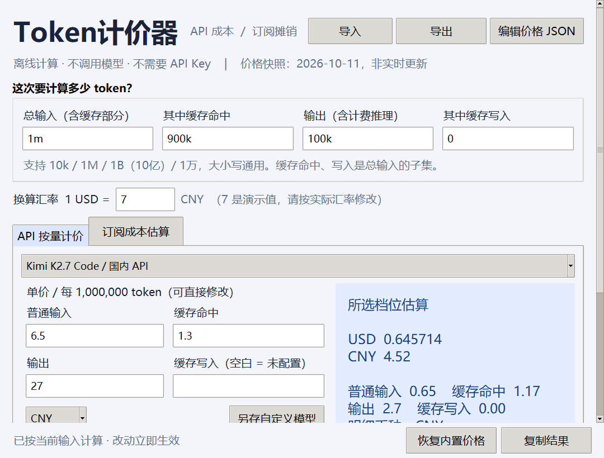
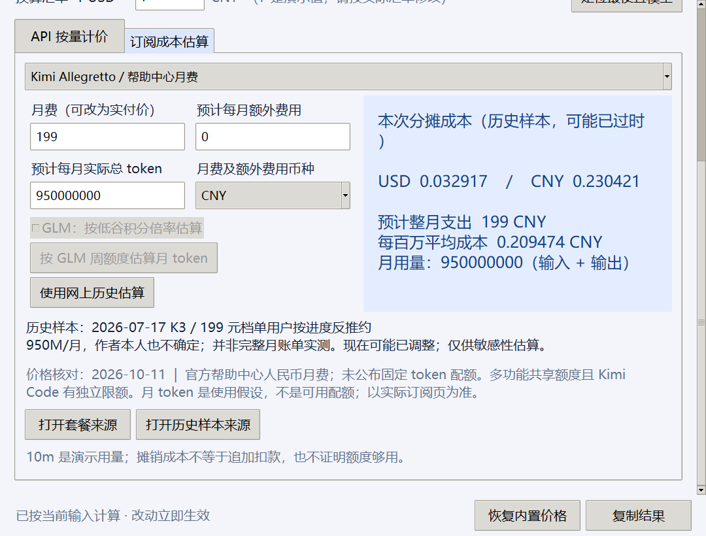

<div align="center">

# TokenPricer · Token计价器

English | [中文](README.zh.md)

**Turn token counts into costs, with your own editable prices.**


[**Download Windows EXE**](https://github.com/menzi11/TokenPricer/releases/latest) · [Price sources & estimation rules](docs/pricing-sources.md) · [Custom price format](docs/configuration.md)

</div>

TokenPricer is a small, offline desktop calculator with a Chinese interface. Enter input and output tokens to estimate API charges, or allocate a monthly subscription cost to a workload. It includes OpenAI, Claude, Gemini, DeepSeek, Kimi, GLM and Cursor price profiles.

Official price tables provide the rates; TokenPricer combines those rates with your token counts, cache usage and currency conversion. For subscriptions, it keeps official GLM credit calculations separate from historical Kimi/Cursor community estimates. Every preset includes a source and a checked date, so you can inspect the assumptions behind a number.



## Calculate API costs

Input, cached input, cache writes and output are priced separately using decimal arithmetic. Cached reads and writes are subsets of total input, preventing double counting. Select the appropriate context or peak/off-peak profile before calculating. Output should include any billed reasoning tokens.

## Estimate subscription costs

See the monthly budget, average cost per million tokens and allocated cost of the current workload. Enter expected monthly usage yourself, use the GLM weekly-credit formula, or explicitly load an available historical community sample. An allocation is **not an additional invoice charge** and does not establish that your subscription has enough capacity.



## Keep your own prices

Edit unit rates in the window and save a named model. The built-in JSON editor can also update subscription prices and assumptions. Import/export accepts UTF-8 `.json` or `.txt` containing JSON. Invalid files are rejected before replacing the active catalog. Saved custom prices load automatically on the next launch.

## Work in either currency

Presets retain their original USD or CNY currency. Results show both currencies using a rate you supply. The default **7 CNY per USD is an example**, not a live exchange rate. Domestic and international API prices are separate presets.

## Inspect the evidence

The initial snapshot was checked on **2026-10-11**. The application does not fetch prices automatically. Model rates, promotions, subscription rules and community estimates can become outdated. GLM international Pro/Max monthly fees are explicitly marked as reference values pending checkout verification. Read the [source notes](docs/pricing-sources.md) before relying on a subscription estimate.

Other conveniences: `10k`, `1M`, `1B`, `1.5B`, `1万` in every token field (case-insensitive; `1B` = 1,000,000,000); instant recalculation; copy results; restore built-in prices; scrollable layout for shorter/high-DPI screens. No API key, account connection or network request is required to calculate. Opening a source link launches your browser.

## Start

Download `TokenPricer.exe` from [Releases](https://github.com/menzi11/TokenPricer/releases/latest) and double-click it. Python is bundled. The initial binary targets Windows x64 and is not code-signed.

To run from source, install Python 3.11+ with Tk and run:

```powershell
python app.py
```

Only Python's standard library is needed at runtime. Other operating systems have not been validated.

<details>
<summary>Development and build</summary>

```powershell
python -m unittest discover -s tests -v
powershell -ExecutionPolicy Bypass -File build.ps1
```

GUI tests require a desktop/Tk environment. `build.ps1` creates a local virtual environment, installs pinned PyInstaller, tests the app and creates `dist/TokenPricer.exe`. Preview screenshots can be regenerated with `tools/capture_preview.py` after installing Pillow in the development environment.

</details>

[MIT License](LICENSE)
